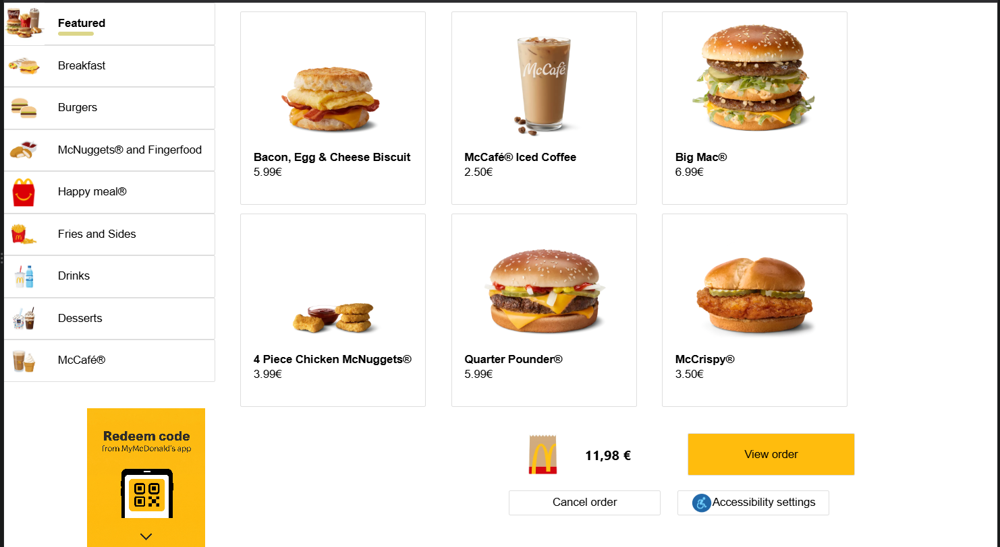
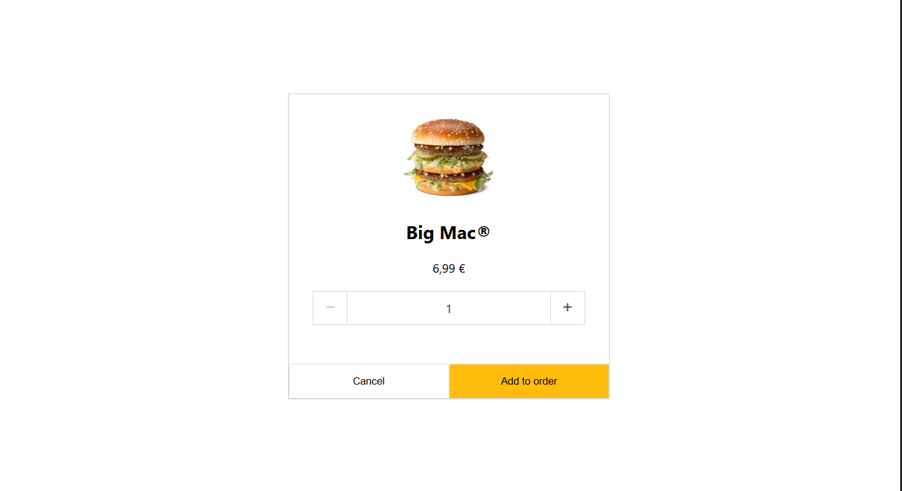
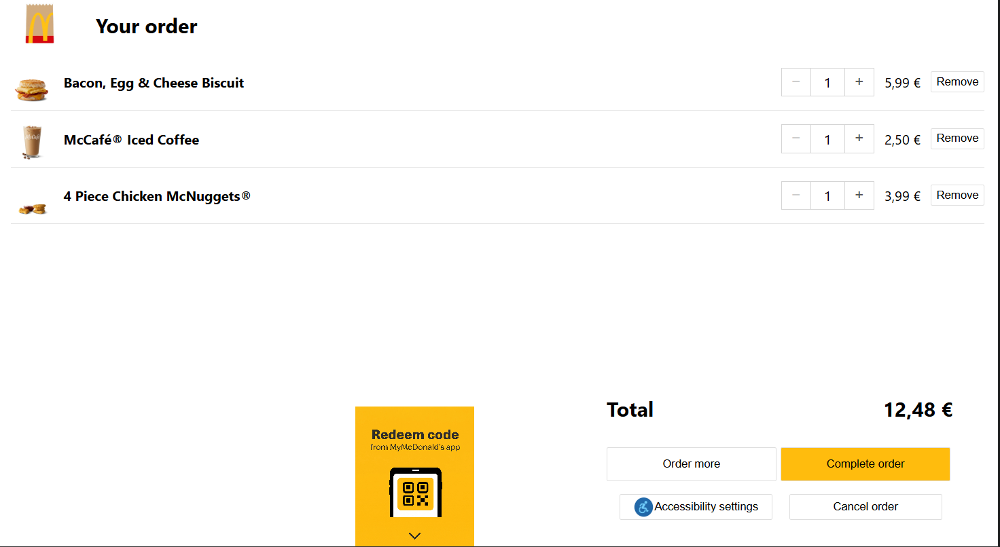
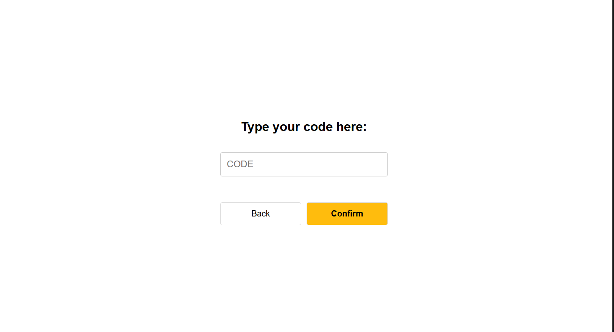

# McDonald's ordering kiosk

This is a reacreation of Mc McDonald's ordering kiosk.

**DISCLAMER: This project was created solely for educational purposes as part of Hack Club and is not affiliated with McDonald's. All product names, logos, and images are the property of the McDonald's company**

# Description

Project focuses on recreating the ordering kiosk as close to the orignal as posible. It has most of the menu items you will typically find in McDonald's . It also has the discount code system and the recipt generator.

# Demo

If you want to try this project you can visit this site https://enderx20.github.io/McDonalds-ordering-kiosk

# Screenshots

